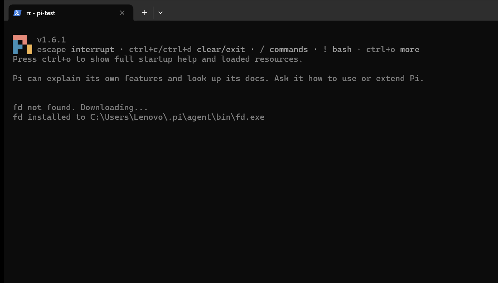
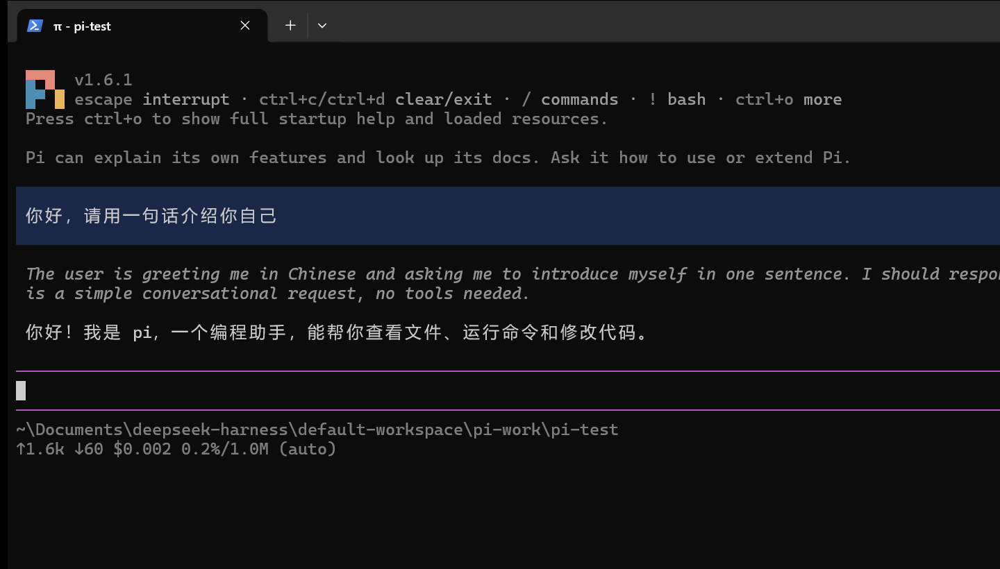
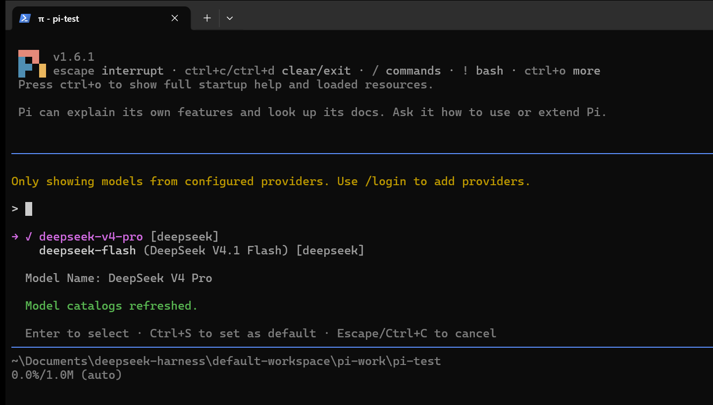
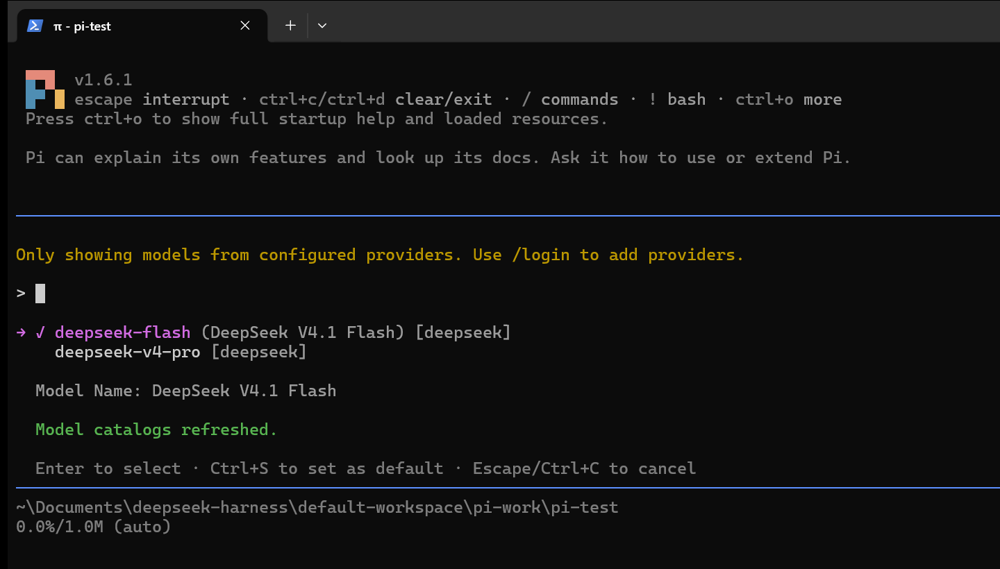
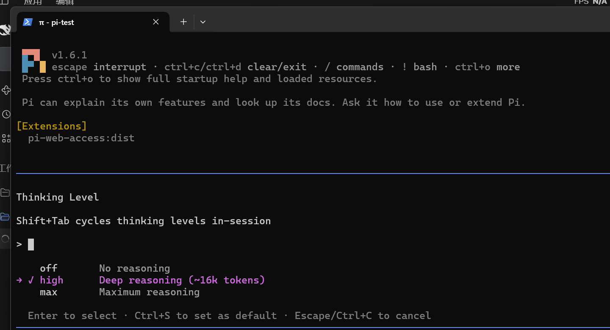
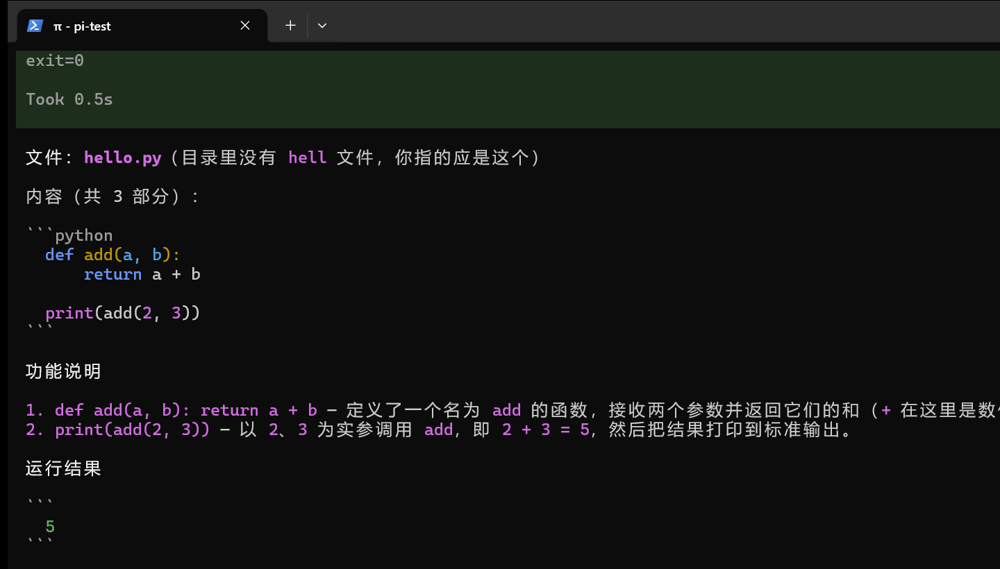
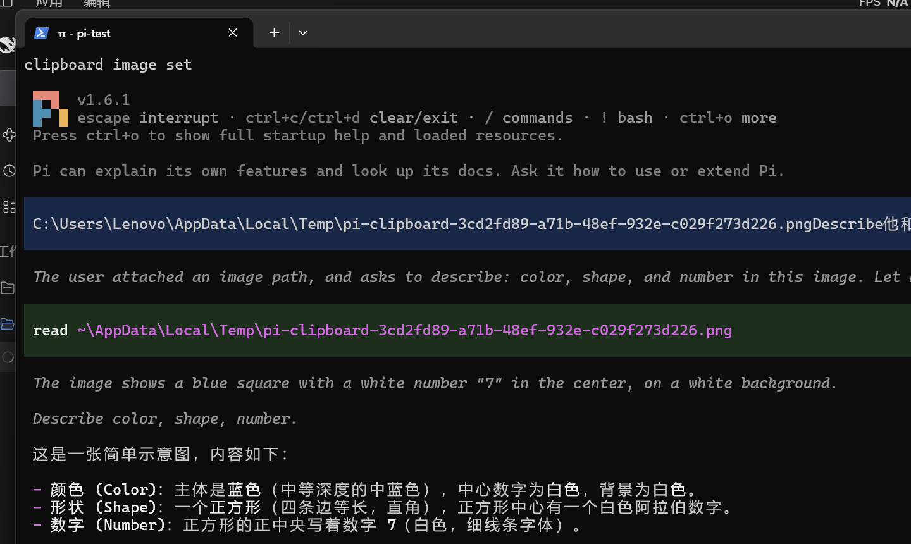
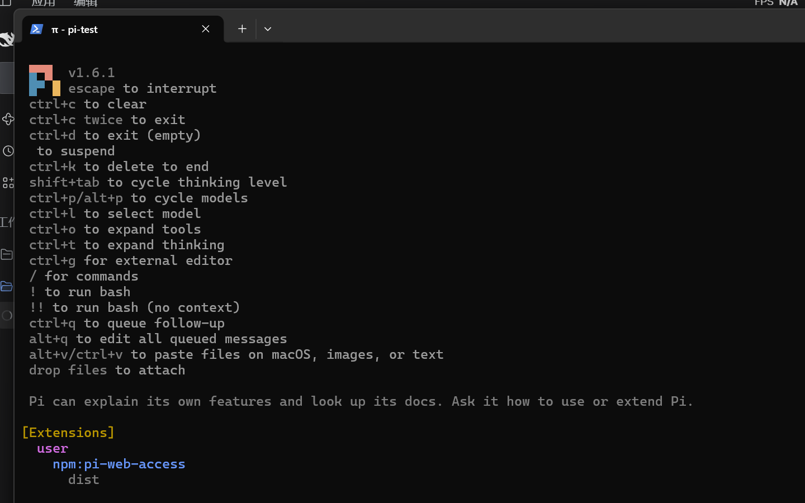
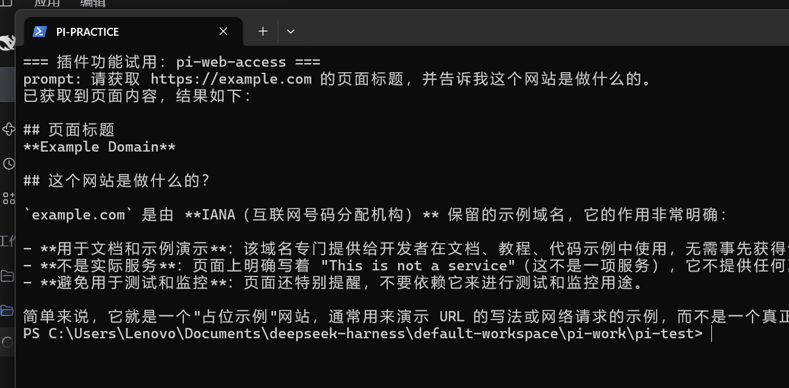

# 实践课1：Pi Agent 安装与使用

- 姓名：王陈业（Wangchenye）
- GitHub 登录名：rtzsh
- 系统：Windows 11 / PowerShell

## 任务一 本地安装并启动

官方安装器是 `irm https://pi.dev/install.ps1 | iex`。我先把这个脚本下载下来读了一遍，
确认它只是调用 npm 安装 `@earendil-works/pi-coding-agent` 并处理 PATH，没有其他动作。
因为本机已经装好 Node.js v24.18.0 和 npm 11.16.0，我改用官方文档允许的 npm 方式安装，
省掉安装器里关于是否安装 Node.js 和 Git Bash 的交互提问：

```powershell
npm install -g --ignore-scripts --min-release-age=0 @earendil-works/pi-coding-agent
pi --version   # 1.6.1
```

安装位置：`C:\Users\Lenovo\AppData\Roaming\npm\pi.ps1`

启动后在 `pi-test` 目录下运行 `pi`，能看到版本号和当前目录：



> 这张图里能看到 v1.6.1 和窗口标题中的 `pi-test` 目录名。首次启动时它还自动下载了
> `fd` 和 `ripgrep` 两个搜索工具。

## 任务二 配置模型并完成一次会话

用的 DeepSeek 的 API Key。配置过程中踩了一个坑，见下面"遇到的问题"第 1 条。

配置完成后发送"你好，请用一句话介绍你自己"，模型正常回复：



图里可以同时看到：我发的提示词、模型的思考过程（斜体部分）、最终回复，
以及底部状态栏里的上下文占用 `0.2%/1.0M (auto)` 和费用统计。

## 任务三 切换模型与思考级别

**模型切换**：用 `/model` 打开选择器。切换前当前模型是 `deepseek-v4-pro`：



再选 `deepseek-flash`，切换后选择器里的勾选位置和 `Model Name` 都变成了 DeepSeek V4.1 Flash：



切换后我用 flash 问了一个短问题（持续集成），仍能正常对话，说明切换生效。

**思考级别**：用 `/thinking` 打开面板，选到 `high`（Deep reasoning (~16k tokens)），
面板里也写着 `Shift+Tab` 可以在会话中循环切换：



我的选择依据：日常问答、改错别字这类任务用 `off` 或低级别就够，速度快；
需要读代码、排查构建失败这种要推理的任务才开到 `high`，因为高级别更慢、更费 token。
这次实践中模型切换和思考级别是两件独立的事——换模型是换"谁来回答"，
调级别是调"同一个模型想多久"。

## 任务四 引用代码文件与粘贴小图片

### A 用 `@` 引用文件

在 `pi-test` 建了 `hello.py`：

```python
def add(a, b):
    return a + b

print(add(2, 3))
```

在 Pi 里输入 `@`，候选列表里选 `hello.py`，再问"请解释这个文件的功能…"。
回复里正确解释了 `add` 函数并给出输出 `5`：



### B 粘贴小图片

自己画了一张 200×200 的图：蓝底方块、中间白色数字 7（原图见下）。


切到支持图片输入的 `deepseek-flash`，用 `Alt+V` 粘贴，输入
"Describe the color, shape and number in this image."，模型识别出蓝色方块和数字 7：



> 注意：粘贴后 Pi 会把剪贴板图片落成一个临时 png 再传给模型（图里能看到
> `pi-clipboard-....png` 被 read 工具读取）。模型确实"看"到了图，而不是我在提示里告诉它的。

## 任务五 安装并使用一个插件

选的是 `pi-web-access`（给模型提供网页抓取能力）。

```powershell
pi install npm:pi-web-access
# Installing npm:pi-web-access...
# added 211 packages in 24s
# Installed npm:pi-web-access
```

安装后退出原会话、重新 `pi`，启动帮助（`Ctrl+O`）里的 `[Extensions]` 区域能看到加载结果：



试用：让它获取 https://example.com 的页面标题。



返回了标题 `Example Domain` 和这个域名的用途说明。加载成功和功能可用这两件事我都分别截图了。

## 任务六 PPT Skill（选做）

本次没有做。原因：`.pi/skills` 的安装和调用需要先确认 Node.js/pptxgenjs 与 Python 转换工具链，
时间上优先保证必做项完成。不假装做过。

## 遇到的问题

### 1. `No models available`，但明明已经装了客户端

**现象**：`pi` 能启动，但 `--list-models` 提示没有模型，同时报：

```
Warning: errors loading models.json:
Invalid models.json schema:
  - providers.company-pi-plan.apiKey: must not have fewer than 1 characters
File: C:\Users\Lenovo\.pi\agent\models.json
```

**排查**：打开 `~\.pi\agent\models.json`，发现里面残留了一个 `company-pi-plan` 提供商配置，
`apiKey` 是空字符串，`baseUrl` 指向一个第三方网关，还有些模型名的中文是乱码。
JSON Schema 校验要求 `apiKey` 至少 1 个字符，只要有一条不合法，**整份配置都加载失败**，
于是连内置的 deepseek 提供商也一起消失了。

**解决**：备份后移走坏文件，让 Pi 用内置 provider 列表：

```powershell
Copy-Item ~\.pi\agent\models.json ~\.pi\agent\models.json.broken-backup
Remove-Item ~\.pi\agent\models.json
```

然后设置环境变量（不把密钥写进配置文件）：

```powershell
$env:DEEPSEEK_API_KEY = "sk-..."    # 实际值不写进报告
```

`pi --list-models` 立刻恢复：

```
provider  model            context  max-out  thinking  images
deepseek  deepseek-flash   1M       384K     yes       yes
deepseek  deepseek-v4-pro  1M       384K     yes       no
```

**收获**：一个配置文件里只要有一条不合 schema，整体就失效，报错虽然只指向某一行，
但影响的是"全部提供商"。以后先看报错里的具体字段，再决定是整个删除还是只改那一条。

### 2. 中文粘贴进 TUI 变乱码

**现象**：往 Pi 输入框粘贴中文，界面显示成 `漩风敷涓€壅...`。

**原因**：我用 PowerShell 5.1 脚本把中文写进剪贴板，脚本文件是 UTF-8 无 BOM，
PS 5.1 按 GBK 读取，写进剪贴板的已经是坏字符串。**不是 Pi 的问题**。

**解决**：改成从 UTF-8 文本文件读取，并显式指定编码：

```powershell
$txt = [System.IO.File]::ReadAllText($path, [System.Text.UTF8Encoding]::new($false))
Set-Clipboard -Value $txt.Trim()
```

另外在旧版 conhost 里 TUI 的备用屏渲染不完整，加 `--tui-mode regular` 后输入框和状态栏正常显示。

### 3. TUI 里的中文日志和终端输出乱码

**现象**：`console.error` 打印的中文日志显示成乱码，但模型回复的中文正常。

**原因**：控制台代码页是 936（GBK），Node 输出的是 UTF-8；而且 PowerShell 5.1 在合并 stderr 时
还会按另一套编码解码。

**解决**：先 `chcp 65001`，再把 `[Console]::OutputEncoding` 和 `InputEncoding` 都设成 UTF-8，
并且不再用 `2>&1` 让 PowerShell 中转 stderr。
