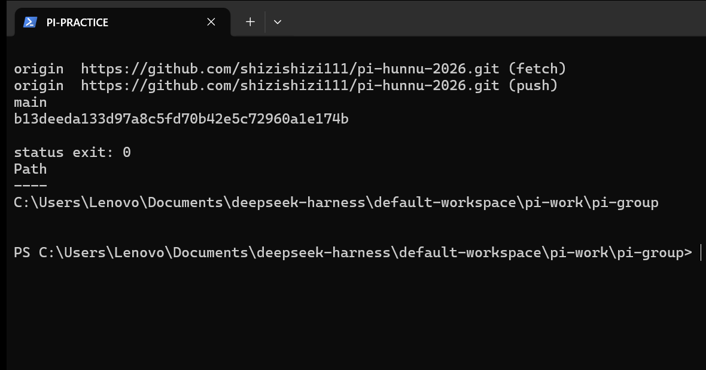
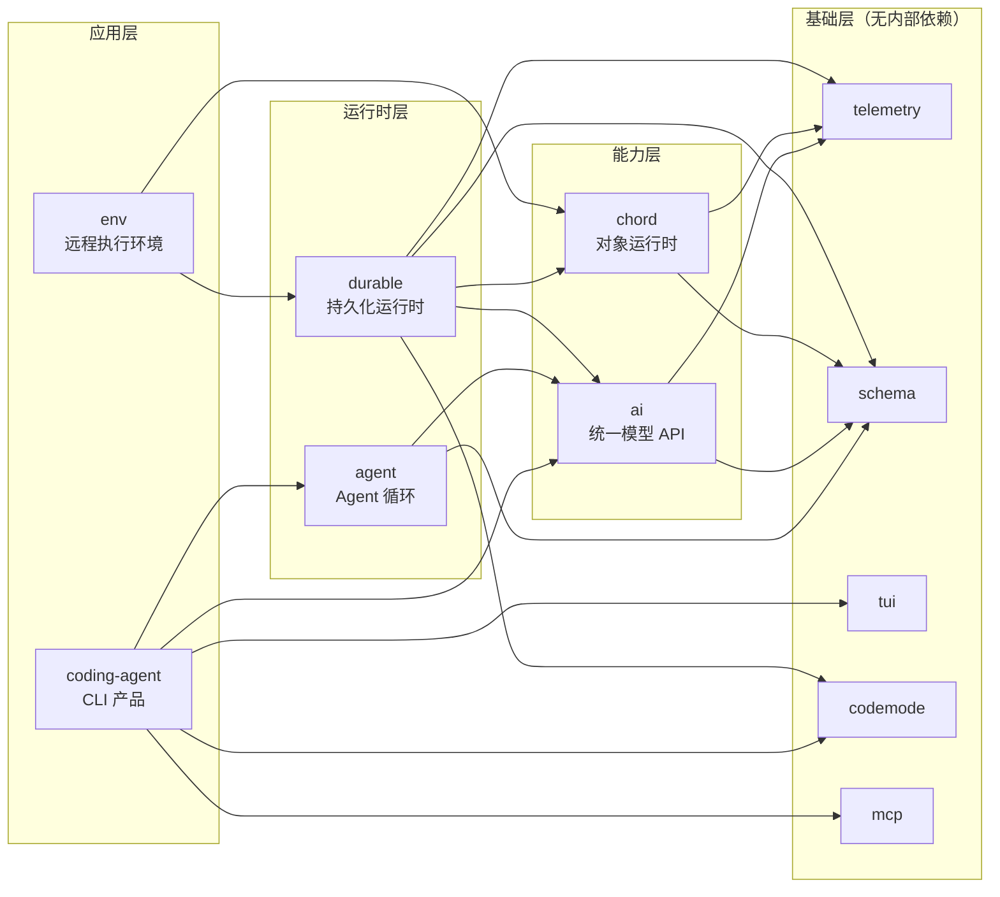
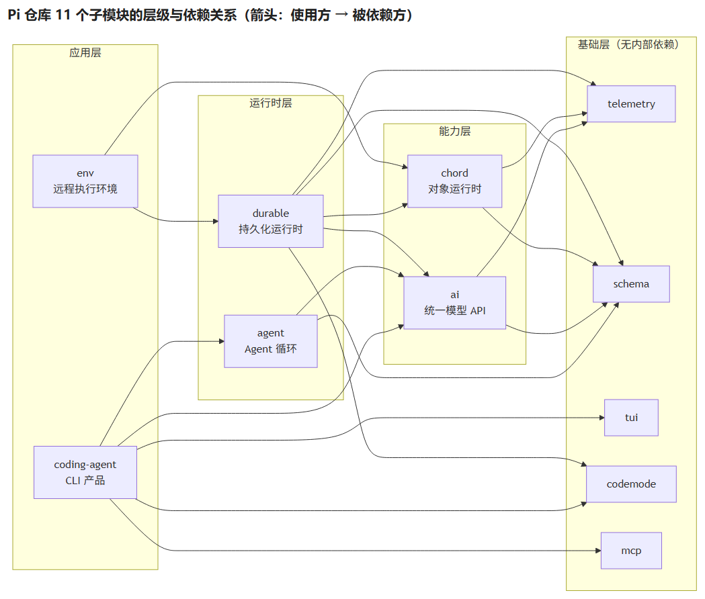

# 实践课2：组织建仓与 Pi Agent 源码分析

## 1. 源码获取

- 小组代码仓库：https://github.com/shizishizi111/pi-hunnu-2026
- 本人克隆地址：`https://github.com/shizishizi111/pi-hunnu-2026.git`
- 本地提交编号：`b13deeda133d97a8c5fd70b42e5c72960a1e174b`
- 分支：`main`

```powershell
git clone --branch main https://github.com/shizishizi111/pi-hunnu-2026.git
cd pi-hunnu-2026
Get-Location
git remote -v
git branch --show-current
git rev-parse HEAD
git status --short
```



> 说明：我核对时发现小组 fork 的 `HEAD^{tree}` 与教师仓库当前 `main` 不一致，
> 说明小组仓库是较早的 fork 版本（`packages/coding-agent` 版本号 1.5.2）。
> 因此后文所有分析、构建都以**小组仓库 `b13deed`** 为准，不套用教师仓库的行号。

## 2. 仓库结构概览

这个仓库是一个 npm workspaces 单仓库（monorepo）：根目录只有配置和脚本，
真正的代码在 `packages/` 下，共 13 个子包，本次课程要求分析其中 11 个
（`evals` 是评测工具，不在构建链上）。

```text
pi-hunnu-2026/
├── package.json          # workspaces + 串行 build 脚本
├── package-lock.json     # 锁定依赖版本
├── pi-test.bat / .ps1    # 用源码方式启动本地版本
├── scripts/              # 构建、打包、校验用的脚本
└── packages/
    ├── telemetry/  schema/  chord/  tui/  codemode/
    ├── mcp/  ai/  durable/  env/  agent/  coding-agent/
    └── evals/
```

## 3. 十一个子模块分析

| 子文件夹 | 代码主要实现什么功能 | 本模块 build 执行什么、生成什么 | 直接依赖哪些内部模块 | 依据文件或代码位置 |
|---|---|---|---|---|
| `telemetry` | 与厂商无关的遥测契约：`TelemetryContext`/`TelemetrySpan`、计数器/直方图等指标类型，以及一份 `InMemory` 参考实现，供其他包打点而不绑定具体后端 | `tsc -p tsconfig.build.json`，把 TypeScript 编译到 `dist/`，产出 `dist/index.js` 与类型声明 | 无 | `packages/telemetry/package.json`、`packages/telemetry/README.md` |
| `schema` | 不依赖 `eval` 的 JSON Schema 校验器：把 schema 编译成闭包，支持 2020-12 与 draft-7，错误用 JSON Pointer 定位 | 同上，`tsc` 编译到 `dist/` | 无 | `packages/schema/README.md`、`packages/schema/package.json` |
| `chord` | 跨进程「对象运行时」：对象契约、文档存储与事务、引用与链接、插件热重载、HTTP 与 worker 承载 | `tsc` 编译到 `dist/`，产出运行时库（源码 320 个文件，是体量最大的基础包之一） | `pi-schema`、`pi-telemetry` | `packages/chord/README.md`、`docs/design.md` |
| `tui` | 终端界面库：差分渲染（只重绘变化行）、同步输出（CSI 2026）防闪烁、备用屏视口与鼠标/键盘滚动、括号粘贴 | `tsc` 编译到 `dist/`；另有 `build:native:*` 针对各平台的原生辅助构建 | 无 | `packages/tui/README.md` |
| `codemode` | 在 QuickJS（WASM）沙箱里执行模型写的 JavaScript，唯一能力是调用注入的工具；嵌套工具调用不进入 LLM 上下文 | `tsc` 编译到 `dist/` | 无 | `packages/codemode/README.md` |
| `mcp` | 独立的 MCP（Model Context Protocol）客户端：stdio 与 Streamable HTTP 传输、内存传输，不依赖官方 SDK | `tsc` 编译到 `dist/` | 无 | `packages/mcp/README.md` |
| `ai` | 统一的大模型调用层：多家 provider 适配、鉴权解析、token 与费用统计、会话中途换模型、模型目录 | 先 `node catalog/generate.ts --strict` 生成模型目录数据，再 `check:model-data && tsc -p tsconfig.build.json`，最后把 `src/providers/data` 复制进 `dist/providers` | `pi-schema`、`pi-telemetry` | `packages/ai/package.json` 的 `scripts.build`、`catalog/generate.ts` |
| `durable` | 可持久化的会话/任务运行时：对话、模型轮次、工具调用先落盘再展示，进程崩溃后能从中断处续跑 | `tsc` 编译到 `dist/` | `chord`、`pi-ai`、`pi-codemode`、`pi-schema`、`pi-telemetry` | `packages/durable/README.md` |
| `env` | 远程执行环境：一个跑在远端（通常经 SSH）的 Rust 守护进程，加上 `RemoteExecutionEnv` 客户端，让工具在另一台机器上执行 | `tsc` 编译到 `dist/`（`daemon/` 是 Rust 程序，不在 npm build 里） | `chord`、`pi-durable` | `packages/env/README.md`、`docs/protocol.md` |
| `agent` | Agent 核心循环：把上下文交给模型、拿回工具调用、执行工具、把结果写回消息列表，直到模型不再调用工具 | `tsc` 编译到 `dist/` | `pi-ai`、`pi-schema` | `packages/agent/src/agent-loop.ts`、`agent.ts` |
| `coding-agent` | 命令行产品：`read`/`bash`/`edit`/`write` 等工具、会话管理、交互界面，最终打包成可执行 CLI | `tsc -p tsconfig.build.json` 生成 `dist/`，再执行 `scripts/build-coding-agent-bundle.mjs` 打包成 `dist/bundle/cli.js`，并复制主题、模板等资源 | `pi-agent-core`、`pi-ai`、`pi-codemode`、`pi-mcp`、`pi-tui` | `packages/coding-agent/package.json` 的 `scripts.build`、`bin.pi` |

## 4. 模块层级与依赖关系图

箭头方向统一为「使用方 → 被依赖方」。实线为运行时依赖（`dependencies`）；
本次 11 个包之间没有内部 `devDependencies`，所以图中不区分开发依赖。



**层级划分依据**：按「一个包依赖多少内部包」和「它在运行时的位置」划层。
完全不依赖其他内部包的 5 个包放在基础层；只依赖基础层的 `ai`、`chord` 属于能力层，
它们分别把「模型调用」和「对象/状态管理」包装成可复用能力；`agent`、`durable` 站在能力层之上，
组装出「会调用工具的循环」和「可恢复的运行」；`coding-agent`、`env` 是最终形态——
一个是给人用的 CLI，一个是把工具搬到远端机器上跑。

## 5. 三个问题的回答

### 5.1 根目录与子模块的 `npm run build` 分别读取什么配置、执行什么工作？

根目录 `npm run build` 读取的是根 `package.json` 里的 `scripts.build`，它的内容是一长串
`cd packages/xxx && npm run build && cd ../yyy && ...`，也就是**串行**依次进入每个子包执行各自的 build，
`&&` 保证前一个成功才继续。

子包的 `npm run build` 读取该子包自己的 `package.json` 和 `tsconfig.build.json`：
`tsc -p tsconfig.build.json` 会读取该 tsconfig（以及它继承的根 tsconfig）中的 `outDir`、`rootDir`、
`include` 等配置，把 `src/` 下的 TypeScript 编译成 `dist/` 下的 JS 和 `.d.ts`。
有两个包不只是 `tsc`：

- `ai`：先跑 `catalog/generate.ts` 生成模型目录数据（需要联网），再校验数据、编译，最后复制 `src/providers/data`。
- `coding-agent`：先编译，再跑 `build-coding-agent-bundle.mjs` 打成单文件 bundle，并复制主题与 HTML 模板。

所以「`npm run build` 到底做什么」完全由项目自己的配置决定，npm 本身只负责执行脚本。

### 5.2 构建顺序和模块依赖有什么关系？相邻构建的模块是否一定互相依赖？

构建顺序是：`telemetry → schema → chord → tui → codemode → mcp → ai → durable → env → agent → coding-agent`。

这个顺序大体遵循「被依赖的在前」：`telemetry`、`schema` 最先，`chord`、`ai` 依赖它们所以排在其后，
最后才是依赖最多的 `coding-agent`。因为 tsconfig 的 `references`/包解析需要依赖方已经产出 `dist`，
顺序错了就会编译失败。

但**相邻构建的两个模块不一定互相依赖**。例如 `chord` 之后立刻构建的 `tui` 与 `chord` 没有任何依赖关系，
`env` 与紧随其后的 `agent` 也没有依赖关系。所以这个顺序是维护者按「基础 → 上层」人工编排的近似拓扑序，
不是由依赖关系自动推导出来的，只要满足「依赖在前」的约束，独立模块谁先谁后都可以。

### 5.3 选择一条涉及至少三个模块的依赖路径，说明这些模块如何分工

选 **`coding-agent → agent → ai → schema`** 这条路径：

- `coding-agent`：产品层。负责和用户打交道——解析命令行参数、启动 TUI 交互界面、
  注册 `read`/`bash`/`edit`/`write` 这些工具、管理会话文件。它决定「用户说一句话之后从哪里开始」。
- `agent`：循环层。`Agent.prompt()` 把当前上下文交给模型，拿到工具调用请求，
  执行工具，再把工具结果 `push` 回消息列表，进入下一轮，直到模型不再要求调用工具。它决定「一轮对话里发生几次模型调用」。
- `ai`：适配层。把不同厂商的 HTTP 接口统一成同一个 `streamFunction(...)` 调用，
  处理鉴权、重试、流式增量、token 与费用统计。它决定「请求怎么发出去、回复怎么流回来」。
- `schema`：校验层。用 JSON Schema 校验工具参数和结构化输出，把「模型生成的 JSON」变成可信的对象，
  错误以 JSON Pointer 定位。它决定「模型给的东西能不能用」。

一句话概括分工：**coding-agent 决定入口，agent 决定循环，ai 决定怎么和模型说话，schema 决定数据是否合法**。

## 6. 图源

Mermaid 源码见本文第 4 节（GitHub 可直接渲染）。另导出 PNG 一份便于离线查看：


