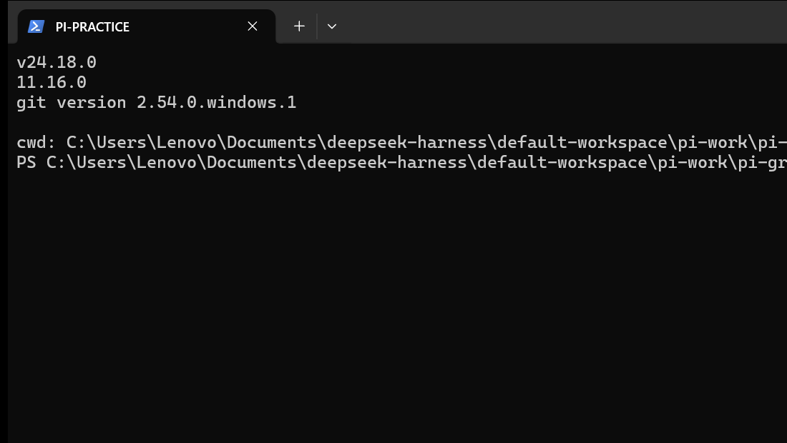
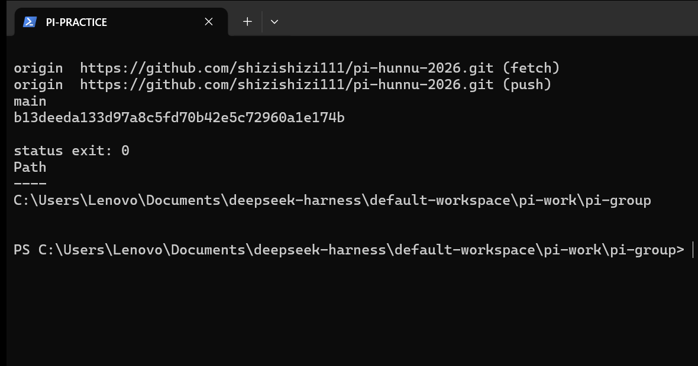
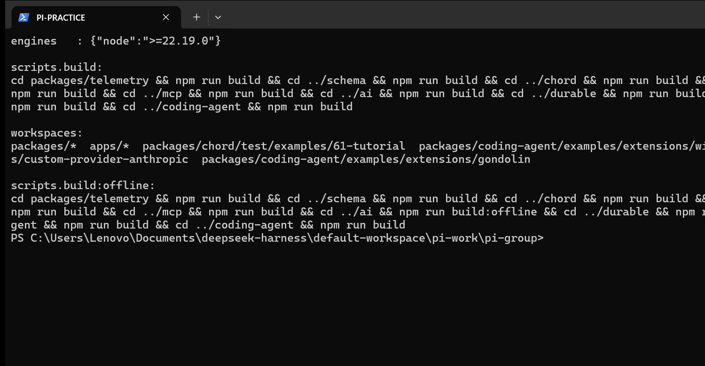
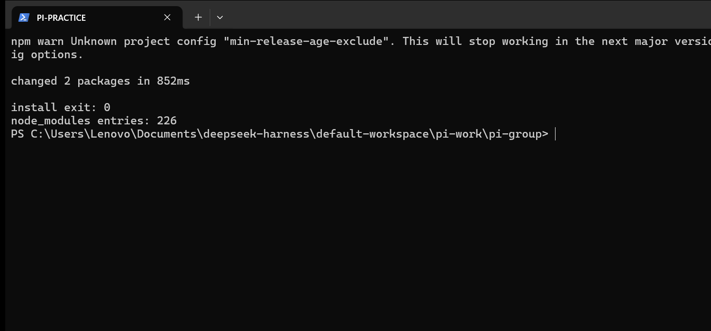
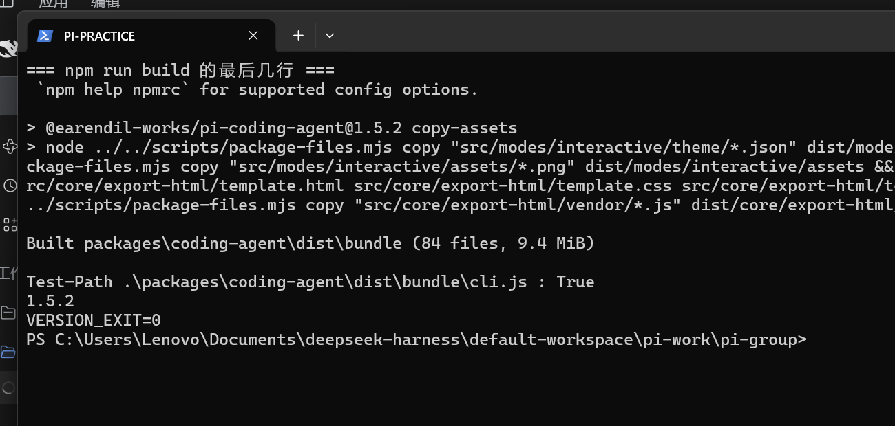
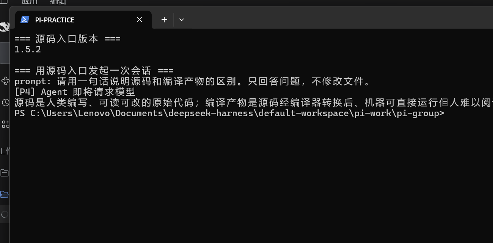

# 实践课3：Pi Agent 源码安装与编译

- 姓名：王陈业（Wangchenye）
- GitHub 登录名：rtzsh

## 任务一 检查开发工具

```
node --version   v24.18.0
npm --version    11.16.0
git --version    git version 2.54.0.windows.1
```



项目根 `package.json` 声明的是 `"node": ">=22.19.0"`，当前 v24.18.0 满足要求。
没有另装 fnm，直接用系统里已有的 Node.js。

## 任务二 下载课程仓库源码

```powershell
git clone --branch main https://github.com/shizishizi111/pi-hunnu-2026.git
cd pi-hunnu-2026
```

| 项目 | 实际值 |
| --- | --- |
| 当前目录 | `...\pi-work\pi-group` |
| origin | `https://github.com/shizishizi111/pi-hunnu-2026.git` |
| 分支 | `main` |
| 提交编号 | `b13deeda133d97a8c5fd70b42e5c72960a1e174b` |
| `git status --short` | 无输出（工作区干净） |



小插曲：小组 fork 的 `HEAD^{tree}` 和教师仓库当前 `main` 不一致，说明小组仓库是较早的 fork
（`packages/coding-agent` 版本 1.5.2）。所以后面所有行号、产物都以小组仓库为准。

## 任务三 阅读配置

`engines`、`workspaces`、`scripts.build` 三处是关键：



**回答作业的问题：**

1. **Node.js 版本要求在哪里？** 在根目录 `package.json` 的 `engines.node` 字段，值是 `>=22.19.0`。
   注意这只是根项目的声明，各子包依赖可能要求更高版本。
2. **`npm run build` 实际从哪里读取命令？** 从根 `package.json` 的 `scripts.build`。
   它的内容是一串 `cd packages/x && npm run build && cd ../y && ...`，
   所以根构建只是"按顺序进每个子包执行子包自己的 build"，真正编译什么由子包的
   `scripts.build`（也就是 `tsc -p tsconfig.build.json`）和依赖的 tsconfig 决定。

这个仓库用 npm workspaces 管理，`workspaces` 里有 `packages/*`、`apps/*` 和几个示例目录，
所以必须从根目录装依赖，不能给每个子包单独建锁文件。

## 任务四 安装项目依赖

```powershell
npm install --ignore-scripts
```



- 首次安装输出 `added 333 packages in 4m`（走代理，慢），复验时输出 `changed 2 packages`、退出码 0。
- `--ignore-scripts` 跳过了 `postinstall`/`prepare` 这类生命周期脚本，避免安装阶段自动构建；
  它不影响后面手动执行 `npm run build`。
- 安装日志里的 `npm warn Unknown project config "min-release-age-exclude"` 不影响安装，
  是 npm 版本对未知配置项的提示。

## 任务五 本地编译与构建产物验证

```powershell
npm run build
```



| 检查项 | 结果 |
| --- | --- |
| 构建最后一行 | `Built packages\coding-agent\dist\bundle (84 files, 9.4 MiB)` |
| 退出码 | 0 |
| `Test-Path .\packages\coding-agent\dist\bundle\cli.js` | `True` |
| `node .\packages\coding-agent\dist\bundle\cli.js --version` | `1.5.2` |

`dist/` 是构建产物，`src/` 才是要改的源码；直接改 `dist` 里的文件会在下次构建时被覆盖。

首次构建需要联网获取模型目录数据（`packages/ai` 的 `generate-models`），
数据缓存在本地后，后续可以用 `npm run build:offline` 跳过这一步。

## 任务六 用源码入口启动并完成一次会话

```powershell
.\pi-test.bat --version    # 1.5.2
.\pi-test.bat -p "请用一句话说明源码和编译产物的区别。只回答问题，不修改文件。"
```



能收到模型回复，说明跑的是刚构建出来的本地源码版本。

**怎么确认跑的是本地源码？** 三个依据：

1. 入口是 `.\pi-test.bat`，它调用 `pi-test.ps1`，由 Node.js 加载源码解析器运行
   `packages/coding-agent/src/cli.ts`，而不是全局安装的 `pi` 命令；
2. 版本号 1.5.2 与小组仓库 `packages/coding-agent/package.json` 一致（全局装的是 1.6.1，对不上）；
3. 输出里出现了源码里才有、全局版本里没有的 `[P4]` 日志（见实践 4 的改动）。

**两个入口各适合什么场景？**

| 入口 | 命令 | 适合场景 |
| --- | --- | --- |
| 源码入口 | `.\pi-test.bat` | 开发和调试：改完 `src` 立刻能跑，报错栈直接指向源码文件 |
| 构建产物 | `node .\packages\coding-agent\dist\bundle\cli.js` | 验证发布形态：检查打包、资源复制、版本号是否正确 |
| 全局安装 | `pi` | 日常使用：只想用工具，不关心源码 |

## 遇到的问题

### 1. `git clone` 连不上 github.com

**现象**：`Failed to connect to github.com port 443 after 21082 ms`，但同一时间浏览器能打开 GitHub。

**原因**：机器上有 `127.0.0.1:7888` 的系统代理，浏览器自动使用，git 不继承系统代理。

**解决**：

```powershell
git config --global http.https://github.com.proxy http://127.0.0.1:7888
```

只对 github.com 生效，不影响其他仓库。

### 2. 首次 `npm install` 卡在下载

**现象**：依赖下载非常慢，4 分钟才装完 333 个包。

**解决**：给 npm 也配上代理后再安装，第二次（有缓存）只要 20 秒：

```powershell
$env:npm_config_proxy = 'http://127.0.0.1:7888'
$env:npm_config_https_proxy = 'http://127.0.0.1:7888'
```

### 3. 构建日志里的中文变乱码

控制台代码页是 936，Node 输出 UTF-8，两边不一致。`chcp 65001` 并把
`[Console]::OutputEncoding` 设为 UTF-8 后正常。
