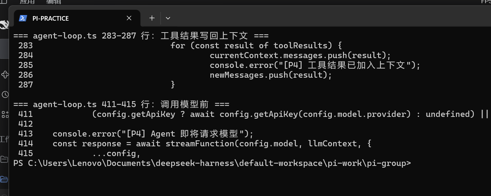
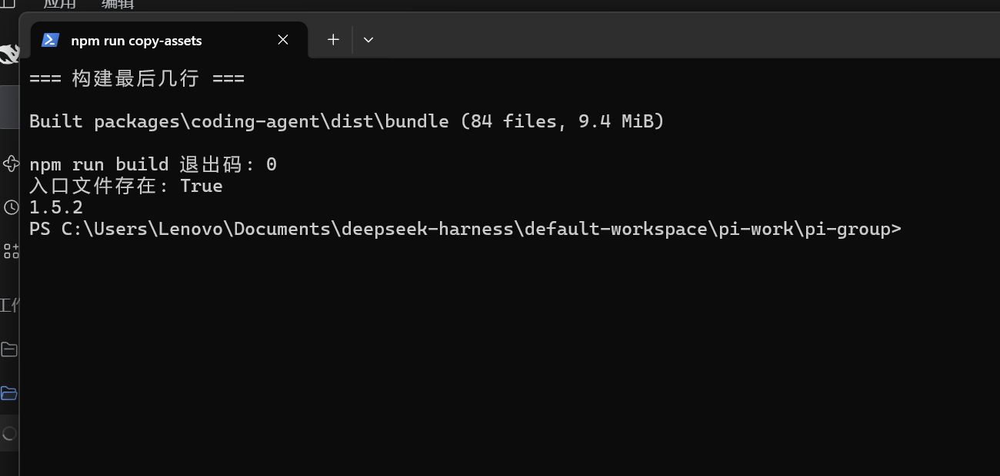
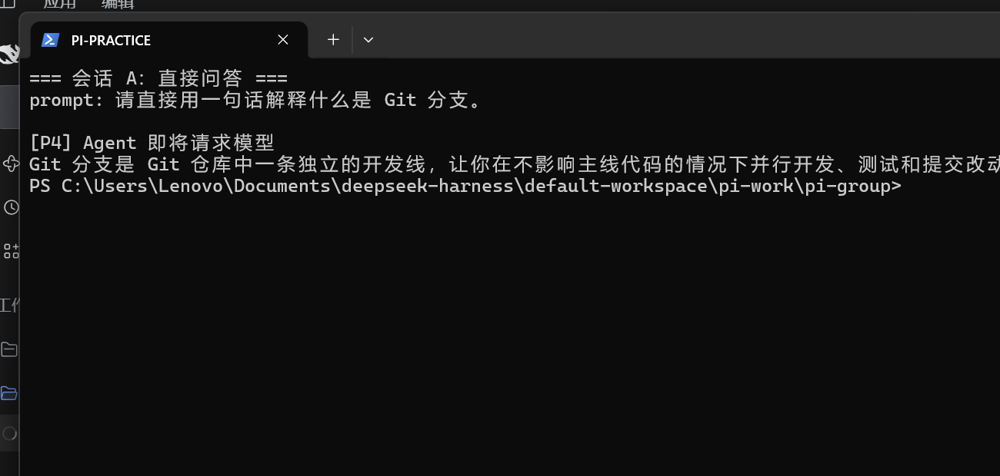
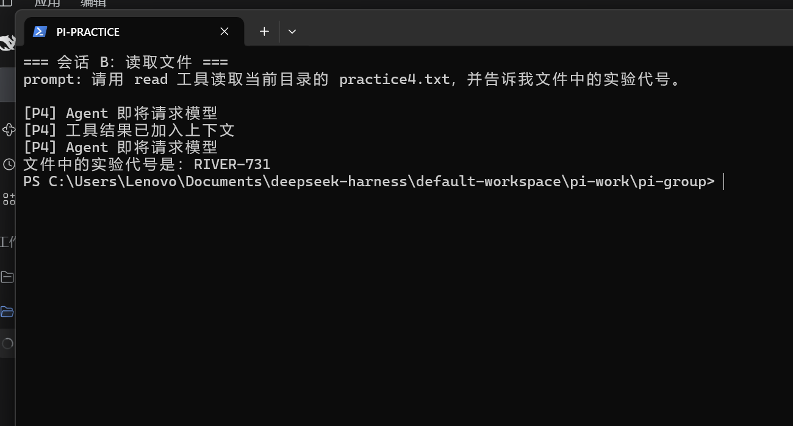

# 实践课4：Pi Agent 模型调用与运行流程

- 姓名：王陈业（Wangchenye）
- GitHub 登录名：rtzsh
- 仓库：https://github.com/shizishizi111/pi-hunnu-2026
- 提交：`b13deeda133d97a8c5fd70b42e5c72960a1e174b`

## 任务一 给 Agent 循环加两行日志

文件：`packages/agent/src/agent-loop.ts`

**注意行号差异**：作业文档写的是第 412 行和 284 行，我们小组版本里
`streamFunction` 在 **414** 行（`console.error` 插在 413），`currentContext.messages.push(result)`
仍在 **284** 行（`console.error` 插在 285）。这是小组 fork 与教师版本的小差异，按搜索语句定位即可。



```ts
// 285 行：工具结果写回上下文之后
for (const result of toolResults) {
    currentContext.messages.push(result);
    console.error("[P4] 工具结果已加入上下文");   // 新增
    newMessages.push(result);
}

// 413 行：每次准备请求模型之前
console.error("[P4] Agent 即将请求模型");         // 新增
const response = await streamFunction(config.model, llmContext, {
    ...config,
    apiKey: resolvedApiKey,
    identity: mergeClientIdentity(DEFAULT_AGENT_IDENTITY, config.identity),
    signal,
});
```

两行日志的位置含义不同：第一行在 `for` 循环体内，**每写入一条工具结果打印一次**；
第二行在每轮循环请求模型的位置，**每进入一轮模型调用打印一次**。

## 任务二 重新编译并启动

```powershell
npm run build
```



| 检查项 | 结果 |
| --- | --- |
| 构建产物 | `Built packages\coding-agent\dist\bundle (84 files, 9.4 MiB)` |
| 退出码 | 0 |
| 入口存在 | `True` |
| 版本 | 1.5.2 |

启动命令（作业要求用编译产物）：

```powershell
node .\packages\coding-agent\dist\cli.js
```

## 任务三 对比两次运行

实验文件 `practice4.txt`（放在仓库根目录）内容：

```
实验代号：RIVER-731
```

### 会话 A：直接问答

指令：`请直接用一句话解释什么是 Git 分支。`



观察结果：

- 只出现 **1 条** `[P4] Agent 即将请求模型`；
- 没有出现 `[P4] 工具结果已加入上下文`；
- 模型直接作答，没有调用任何工具。

说明：这类问题不需要外部信息，Agent 在一轮模型调用里就完成了。

### 会话 B：读取文件

指令：`请用 read 工具读取当前目录的 practice4.txt，并告诉我文件中的实验代号。`



日志顺序（与控制台实际输出一致）：

```
[P4] Agent 即将请求模型
[P4] 工具结果已加入上下文
[P4] Agent 即将请求模型
```

最终回复：`文件中的实验代号是：RIVER-731`

**回答作业的问题：**

1. **两次分别进入了几轮模型调用？**
   A 一次（1 条"即将请求模型"），B 两次（2 条）。
2. **谁实际读了文件？**
   是 `read` 工具，不是模型。日志中间那一行 `工具结果已加入上下文` 说明工具执行完、
   结果被写进了消息列表；模型本身只负责"请求读文件"和"解读读回来的内容"。
3. **下一轮模型请求多带了什么？**
   多带了**工具结果消息**（文件内容）。第一轮请求里只有用户那句话，第二轮请求的上下文中
   多了一条 `toolResult`，模型因此才"看到"了 `RIVER-731`。

### 一张简图

```text
用户输入
   │
   ▼
coding-agent（interactive-mode.ts）── 组装会话、注册 read 等工具
   │
   ▼
agent（agent-loop.ts）── 循环：请求模型 → 执行工具 → 结果写回上下文
   │                         ▲                    │
   │                         └────────────────────┘
   ▼
ai（适配器）── 把上下文翻译成 HTTP 请求 ──► 远端模型服务
   │                                          │
   │◄──────────── 流式返回 toolCall / 文本 ─────┘
   ▼
read 工具 ──► 读本地文件 ──► 结果回到 agent-loop
```

## 遇到的问题

### 1. 日志里的中文乱码

**现象**：`console.error("[P4] ...")` 在控制台显示成乱码，但模型回复的中文正常。

**排查**：先怀疑源码编码错了，于是分别用 UTF-8 和 GBK 读源文件对比：

```
UTF-8 读取：console.error("[P4] 工具结果已加入上下文");
GBK   读取：console.error("[P4] 宸ュ叿缁撴灉...");
```

源码本身没问题，`dist/agent-loop.js` 里也是正确的中文。所以是**显示**问题，不是代码问题。

**原因**：控制台代码页 936（GBK），Node 输出 UTF-8；并且 PowerShell 用 `2>&1` 合并 stderr 时
会按另一套编码解码，导致只有日志乱码、stdout 正常。

**解决**：`chcp 65001`，并把 `[Console]::OutputEncoding`、`[Console]::InputEncoding`
都设为 UTF-8，不再用 `2>&1` 让 PowerShell 中转 stderr。

### 2. 编译产物里找不到 `[P4]` 字符串

**现象**：`Select-String` 在 `dist/bundle/cli.js` 里搜不到 `[P4]`，一度以为日志没编进去。

**排查**：搜索 `packages/agent/dist/agent-loop.js`，能搜到 2 处。

**原因**：`dist/cli.js`（非 bundle）会 `import @earendil-works/pi-agent-core`，
运行时加载的是 workspace 里 `packages/agent/dist` 的代码；而单文件 bundle 是另一个入口，
字符串被处理过，直接搜不到不代表没生效。

**验证**：直接跑 `node .\packages\coding-agent\dist\cli.js`，日志正常输出，证明改的是生效的那份代码。
