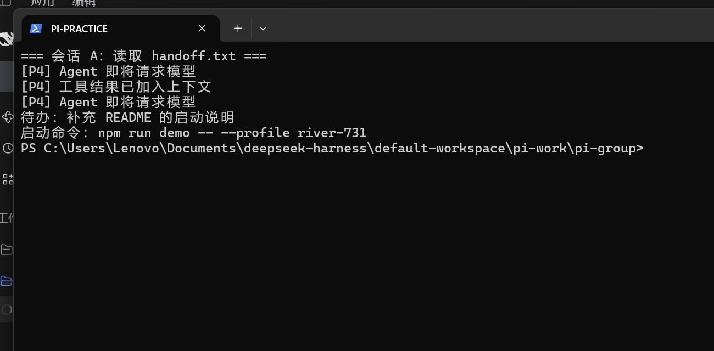
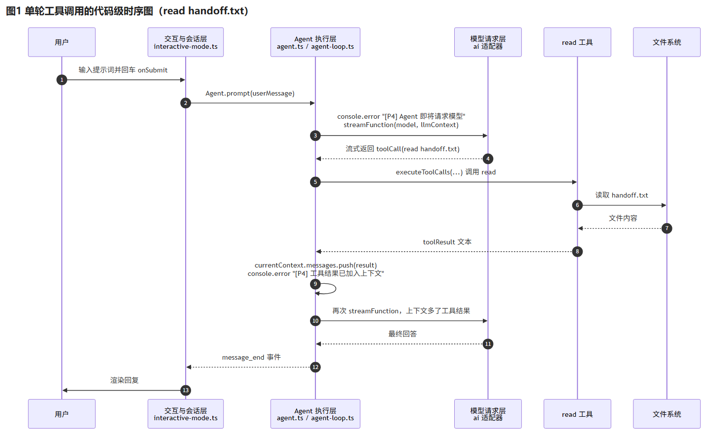
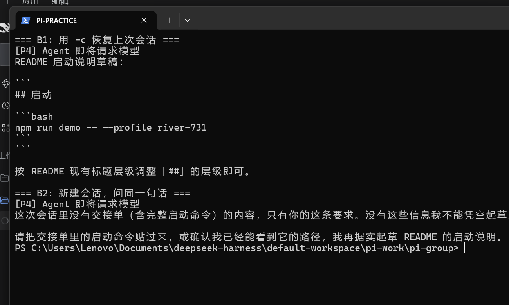
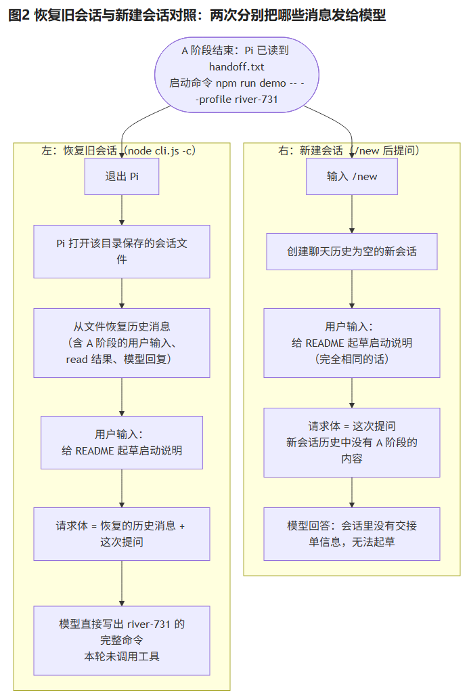

# 实践课5：Pi Agent 工具调用与会话恢复

- 姓名：王陈业（Wangchenye）
- GitHub 登录名：rtzsh

## A. 单轮交互与工具调用

工作目录里放了 `handoff.txt`：

```
待办：补充 README 的启动说明
启动命令：npm run demo -- --profile river-731
```

提问：`请用 read 工具读取当前目录的 handoff.txt，原样告诉我待办和启动命令。`



实际观察到（含实践 4 加的两行日志）：

```
[P4] Agent 即将请求模型
[P4] 工具结果已加入上下文
[P4] Agent 即将请求模型
待办：补充 README 的启动说明
启动命令：npm run demo -- --profile river-731
```

一次用户输入里发生了两次模型调用、一次工具执行。

### 图1 单轮工具调用的代码级时序图



图中每条消息都对应真实代码位置：

- **输入入口**：`interactive-mode.ts` 里编辑器组件的 `onSubmit` 回调；
- **启动循环**：`agent.ts` 的 `Agent.prompt()`，它把用户消息追加到会话上下文后进入 `agent-loop.ts`；
- **模型请求**：`agent-loop.ts` 第 413 行 `console.error("[P4] Agent 即将请求模型")` 之后紧接着的
  `await streamFunction(config.model, llmContext, {...})`，`streamFunction` 来自 `ai` 包，
  由它完成鉴权、HTTP 请求和流式解析；
- **工具执行**：模型返回的 toolCall 交给 `executeToolCalls(...)`，`read` 工具读文件。
  这一版 `read` 走的是**整体读取后再返回**（一次工具结果里带着完整文件内容），
  不是把文件流式塞进上下文——所以日志里"工具结果已加入上下文"是在读完之后才出现的；
- **写回上下文**：第 284-286 行 `currentContext.messages.push(result)` 之后打印第二条日志；
- **显示回复**：最终消息回到 `interactive-mode.ts`，由它订阅的 `message_end` / `message_update`
  分支渲染到屏幕，用户才看到答案。

## B. 恢复上次会话，继续写 README

A 阶段结束时，会话历史里已经包含 handoff.txt 的内容和 river-731 这条命令。

### 1. 恢复原会话（`-c`）

退出 Pi 后重新启动并继续该目录最近的会话：

```powershell
node .\packages\coding-agent\dist\cli.js -c -p "接着上次的待办，给 README 起草一条启动说明，
写出交接单里的完整启动命令。只用这次会话已有的信息。不要调用工具。"
```

### 2. 新建会话问同样的话

```powershell
node .\packages\coding-agent\dist\cli.js -p "（同上这句话）"
```

两次的实际结果：



| | B1 用 `-c` 恢复 | B2 新建会话 |
| --- | --- | --- |
| 是否调用工具 | 否（只有 1 条"即将请求模型"，没有"工具结果已加入上下文"） | 否 |
| 回答内容 | 直接写出 `npm run demo -- --profile river-731` 的启动说明草稿 | "这次会话里没有交接单（含完整启动命令）的内容…请把启动命令贴过来" |
| 结论 | 用的是**恢复出来的历史消息**，没有重新读文件 | 新会话历史为空，模型确实不知道 |

这个对比正好证明：`-c` 恢复的是会话文件里的历史消息，而不是重新执行 A 阶段的工具调用；
模型能写出 river-731，只能来自被恢复的聊天记录。

### 图2 恢复旧会话与新建会话的对照



## 用到的启动方式

| 用途 | 命令 |
| --- | --- |
| 新会话 | `node .\packages\coding-agent\dist\cli.js` |
| 恢复本目录最近会话 | `node .\packages\coding-agent\dist\cli.js -c` |
| 交互界面内新建会话 | `/new` |
| 非交互（便于记录日志） | `node .\packages\coding-agent\dist\cli.js -p "问题"` |
