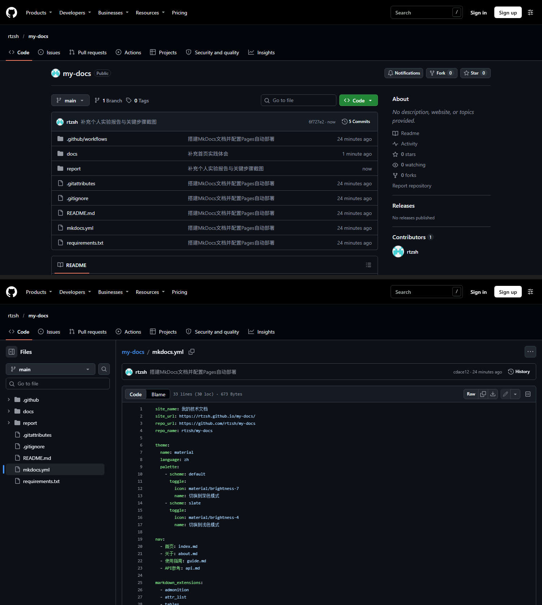
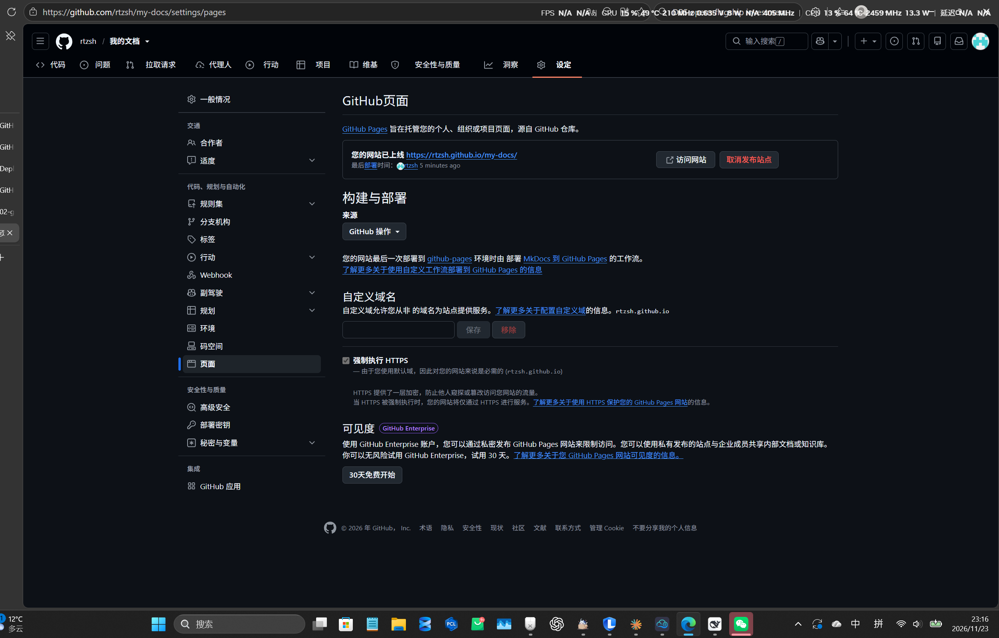
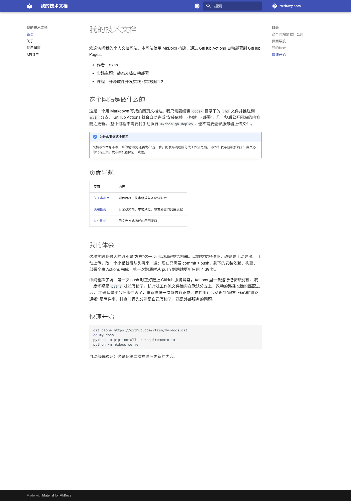

# 实践项目2：个人实验报告

## 1. 基本信息

- 姓名：王陈业（WangChenye）
- GitHub 登录名：rtzsh
- 个人仓库地址：https://github.com/rtzsh/my-docs
- 最终网站地址：https://rtzsh.github.io/my-docs/

## 2. 实践过程与关键截图

### 2.1 仓库创建

在 GitHub 上点击右上角 `+` → `New repository`，Owner 选择本人账号，仓库名 `my-docs`，
可见性选择 **Public**，**不勾选** README / .gitignore / license，创建为空仓库。

之所以建空仓库：本地已经准备好完整的提交历史，空仓库可以直接推送而不产生分叉冲突；
如果初始化了 README，`push` 会被拒绝，还得先 pull 再解冲突，白白多一步。

> 截图①：仓库首页，能看清所有者 `rtzsh`、仓库名 `my-docs` 和 `Public` 标识。


### 2.2 项目结构与 MkDocs 配置

```text
.
├── .github/workflows/deploy.yml   # 自动构建与部署
├── docs/{index,about,guide,api}.md
├── report/{README.md,images/}
├── mkdocs.yml                     # 站点与导航配置
├── requirements.txt
├── .gitignore
└── README.md
```

三个关键点的职责：

- `docs/`：网站**源码**，四页 Markdown 都在这里，`nav` 中写的路径相对它。
- `mkdocs.yml` 的 `nav`：决定侧边栏的顺序和标题，写 `index.md` 而不是 `docs/index.md`。
- `site/`：`mkdocs build` 生成的**产物**，已写进 `.gitignore`，不提交、不手改。

> 截图②：项目目录树 + `mkdocs.yml` 内容（VS Code 侧边栏与编辑器同框即可）。



### 2.3 本地构建与预览

```bash
python -m pip install -r requirements.txt
python -m mkdocs build --strict
python -m mkdocs serve
```

`--strict` 会把警告当错误处理，适合推送前自检；`mkdocs serve` 起本地服务，
改文件会自动重建并刷新浏览器。

检查内容：四个页面导航是否齐全、`about.md` 的表格渲染是否正常、
`api.md` 的 JSON 代码块是否高亮、页面之间的链接能否跳转、提示框（admonition）样式是否生效。

> 截图③：本地预览页面，地址栏可见 `127.0.0.1` 本地地址。


### 2.4 Pages 设置

`Settings` → `Pages` → `Build and deployment` → `Source` 选择 **GitHub Actions**。

这一步的作用是告诉 Pages："不要自己去读某个分支，等 CI 把制品部署过来"。
如果仍停留在 `Deploy from a branch`，工作流即使成功也不会产生网站。
这一页下方会列出 Next.js / Hugo / Jekyll 等模板的「配置」按钮，**这些都不能点**——
它们会生成另一份 starter workflow，与仓库里已有的 `deploy.yml` 重复。

> 截图④：Pages 设置页面，Source 一栏显示 GitHub Actions。



### 2.5 首次构建和部署

首次推送后遇到一个意外：`Actions` 页面显示 **0 条运行记录**（详见第 3 节），
排查确认是当时 GitHub 服务异常导致推送事件丢失，而非配置错误。

重新推送后工作流正常运行，`build` 与 `deploy` 均成功：

| 任务 | 耗时 | 状态 |
| --- | ---: | --- |
| build（检出 → Python 3.12 → 装依赖 → `mkdocs build --strict` → 上传制品） | 17s | 通过 |
| deploy（把制品发布到 `github-pages` 环境） | 10s | 通过 |
| 整次运行 | 39s | Success |

运行记录：https://github.com/rtzsh/my-docs/actions/runs/45200590659

> 截图⑤：成功的 Actions 运行记录，build 与 deploy 两个绿色对勾都在。


### 2.6 网站访问与四页导航检查

访问 https://rtzsh.github.io/my-docs/ ，逐页确认：

| 页面 | 检查点 | 结果 |
| --- | --- | --- |
| 首页 | 正常加载，导航四项齐全 | 通过 |
| 关于 | 表格渲染正常 | 通过 |
| 使用指南 | 代码块高亮正常 | 通过 |
| API 参考 | JSON 代码块、页内链接可跳转 | 通过 |

项目站点的地址必须带仓库路径 `/my-docs/`，直接用 `rtzsh.github.io` 会 404。

> 截图⑥：公开网站首页，保留浏览器地址栏。


### 2.7 第二次推送与自动更新验证

在 `docs/index.md` 末尾增加一句容易辨认的话：
「自动部署验证：这是我第二次推送后更新的内容。」

```bash
git add docs/index.md
git commit -m "验证文档修改后自动更新网站"
git push origin main
```

**没有点任何手动部署按钮**，新的运行由 `push` 自动触发（即上文的 run #1），
成功后刷新网站，新句子出现在首页。

- 对应提交：https://github.com/rtzsh/my-docs/commit/443128f
- 对应 Actions 运行：https://github.com/rtzsh/my-docs/actions/runs/45200590659

> 截图⑦：第二次推送触发的运行记录（提交 `443128f`，Success）。
> 截图⑧：刷新后的网站首页，能看到新增的那句话。




### 2.8 补充：首页"实践体会"

部署成功后发现首页还留着编写阶段的说明性占位文字，于是又补了一次内容修改并推送。
这既完善了正文，也顺带第三次验证了"推送 → 自动更新"这条链路是稳定、可重复的。

## 3. 问题与解决

### 问题一：git 无法连接 github.com（`Failed to connect ... port 443`）

**现象**：`git push` 报 `Failed to connect to github.com port 443 after 21082 ms`，
但浏览器能正常打开 GitHub 页面。

**排查**：浏览器和 PowerShell 的网页请求都正常，只有 git 连不上，说明不是网络本身不通。
检查系统代理设置，发现机器上有 `127.0.0.1:7888` 的代理，浏览器会自动使用，
而 git 默认直连、不读系统代理。

**原因**：git 使用独立的代理配置，不继承 Windows 的系统代理设置。

**解决**：只针对 github.com 配置代理，避免影响其他仓库：

```bash
git config --global http.https://github.com.proxy http://127.0.0.1:7888
```

配置后 `git ls-remote` 立即恢复正常。

### 问题二：推送成功但 Actions 显示 "There are no workflow runs yet"

**现象**：`git push` 返回 `* [new branch] main -> main`，仓库中确实存在
`.github/workflows/deploy.yml`（Actions 侧边栏能列出该工作流），但运行记录数为 0。


**排查顺序**：

1. 确认工作流文件确实在默认分支 `main` 上（抓取 raw 文件，内容完整）；
2. 确认 `paths` 过滤条件与本次改动路径匹配（`docs/**`、`mkdocs.yml` 都有改动）；
3. 确认改动落在默认分支、仓库可见性为 Public；
4. 用"页面截图 + 提交页截图"对照，排除浏览器缓存造成的假象。

以上均正常，因此判断是推送当时 GitHub 服务异常（当时 GitHub 返回 503
"Unicorns have taken over" 错误页）导致事件丢失，属于平台侧问题。

**解决**：重新推送一次（顺带完成作业要求的"第二次推送"），工作流立即被触发并成功。

**收获**：遇到"推送了但没跑"，要先分清是**配置问题**还是**平台问题**，
用"本该出现的证据"逐条核对，而不是反复盲改配置。

### 问题三（预防性核对）

确认 Pages 的 Source 为 `GitHub Actions`，且仓库中没有 `gh-pages` 分支——
本方案使用制品部署，不需要该分支。同时确认未点击 Pages 页面上 Next.js/Hugo 等模板的
「配置」按钮，避免生成重复的工作流。

## 4. 原理理解

### 4.1 `docs/` 和 `site/` 各保存什么？为什么不用手工修改 `site/`？

`docs/` 是源码，存放 Markdown 与配置输入，需要纳入版本管理；
`site/` 是 `mkdocs build` 的输出，由模板、主题和 Markdown 渲染生成，属于可再生成的派生文件。
不手改 `site/` 的理由：一是每次构建都会被整体覆盖，手改无法留存；
二是把产物提交进仓库会让体积膨胀、diff 充满噪声；三是产物容易与源码不同步，
让人分不清线上内容究竟来自哪一版源码。所以 `site/` 写进 `.gitignore`，交由 CI 每次重新生成。

### 4.2 本次工作流在什么情况下自动运行？

推送到 `main` 分支、且改动命中 `paths` 中的路径之一时运行：
`docs/**`、`mkdocs.yml`、`requirements.txt`、`.github/workflows/deploy.yml`。
另外 `workflow_dispatch` 允许在 Actions 页面手动触发，用于首次试跑与排错
（本次排障时手动运行过一次，即 run #2）。

### 4.3 `build` 与 `deploy` 两个任务有什么区别？

`build` 负责"生产"：检出源码、准备 Python 3.12、安装依赖、执行严格构建，
并把 `site/` 上传为工作流制品，它只有 `contents: read` 权限；
`deploy` 负责"发布"：通过 `needs: build` 在前者成功后运行，持有 `pages: write` 与
`id-token: write`，把制品部署到 `github-pages` 环境并输出 `page_url`。
两者分离实现了权限最小化——执行构建代码的那一步拿不到发布权限。

### 4.4 只修改 `report/README.md` 会触发部署吗？为什么？

不会。`paths` 过滤器只匹配 `docs/**`、`mkdocs.yml`、`requirements.txt` 和工作流文件自身，
`report/` 不在其中。原因是报告不参与网站内容，没必要因此重跑构建与部署，
顺带也节省 Actions 的运行时间。

### 4.5 本次方案为何无需创建 `gh-pages` 分支？

因为使用官方 Pages 的"制品部署"模式：`upload-pages-artifact` 把 `site/` 打包成工作流制品，
`deploy-pages` 直接把它交给 Pages 服务，产物不落到任何分支上。
旧方案需要 `gh-pages` 分支承载产物，还要维护分支写权限、处理并发推送冲突；
新方案用 OIDC（`id-token: write`）完成身份校验，不碰仓库内容，因此两者都不需要。

## 5. 提交前自检

- [x] 所有账号、仓库地址已替换为本人信息
- [x] 四页均可访问，导航、表格、代码块正常
- [x] build 与 deploy 均成功，网站公开可访问
- [x] 第二次推送的内容已在网站生效
- [ ] 已在教师仓库提交一条 Issue（标题 `02-github-pages wangchenye`）
