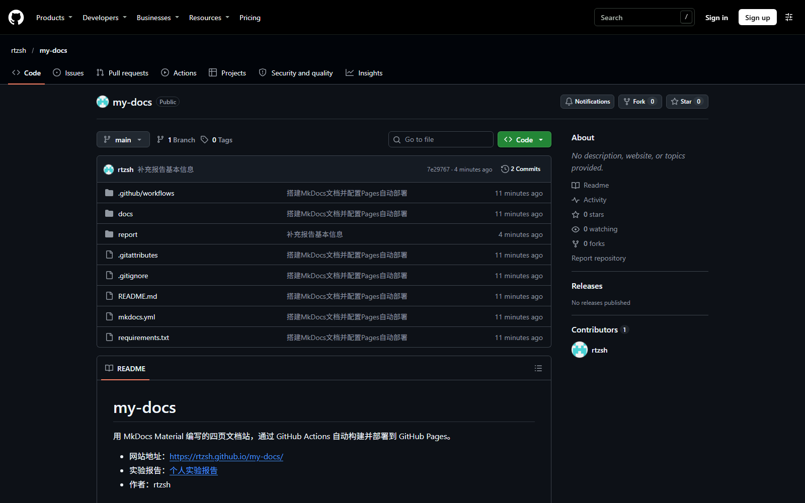
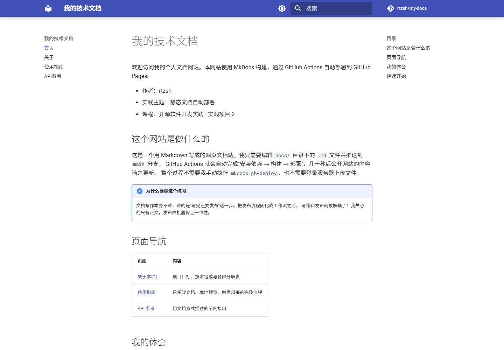
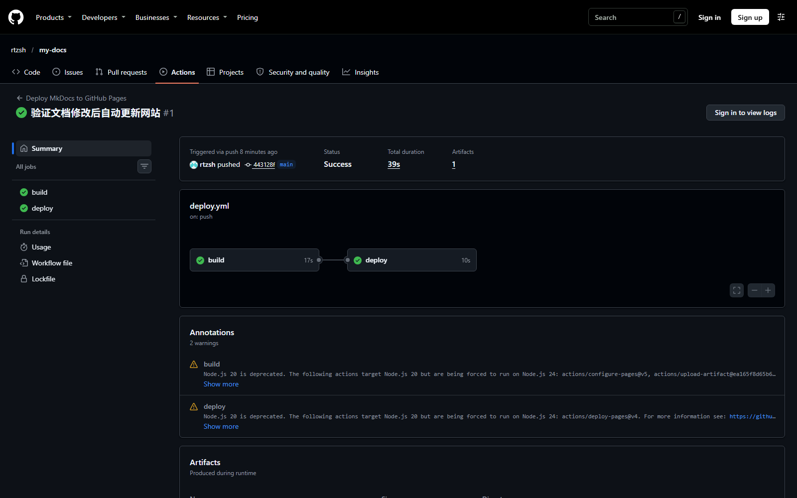
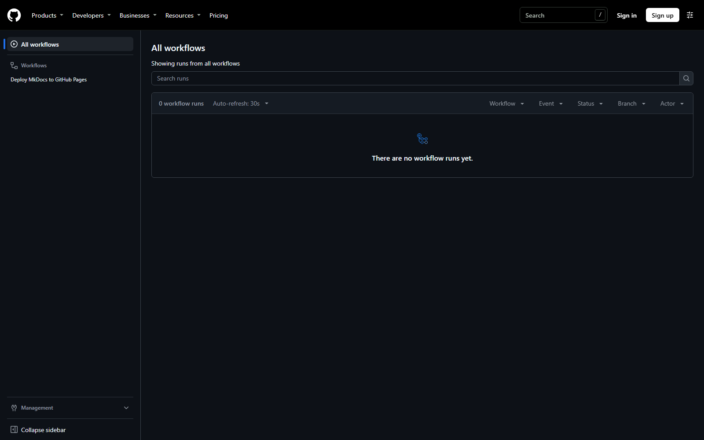

# 实践项目2：个人实验报告

## 1. 基本信息

- 姓名：王陈业（WangChenye）
- GitHub 登录名：rtzsh
- 个人仓库地址：https://github.com/rtzsh/my-docs
- 最终网站地址：https://rtzsh.github.io/my-docs/

## 2. 实践过程与关键截图

### 2.1 仓库创建

点右上角 `+` → `New repository`，Owner 选自己的账号，仓库名填 `my-docs`，可见性选 **Public**，
README、.gitignore、license 三个都**没勾**，建了个空仓库。

不勾 README 是因为我本地已经把文件都写好了，直接推上去最省事。如果建仓库时带了 README，
push 会被拒绝，还得先 pull 下来合并一下，多一步还可能搞出冲突。

> 截图①：仓库首页，能看到所有者 `rtzsh`、仓库名 `my-docs` 和 `Public` 标识。



### 2.2 项目结构与 MkDocs 配置

```text
.
├── .github/workflows/deploy.yml   # 自动构建与部署
├── docs/{index,about,guide,api}.md
├── report/{README.md,images/}
├── mkdocs.yml                     # 站点与导航配置
├── requirements.txt
├── .gitignore
└── README.md
```

写的时候三个地方我特意确认过：

- `docs/` 放的是 Markdown 原文，也就是网站的"源文件"，`nav` 里写的路径是相对于它的。
- `mkdocs.yml` 里的 `nav` 决定左边导航的顺序和名字。我一开始写成 `docs/index.md`，构建直接报错，
  改回 `index.md` 才对。
- `site/` 是 `mkdocs build` 生成的 HTML，属于产物，已经写进 `.gitignore`，不提交也不手改。

> 截图②：仓库里的文件列表，以及 `mkdocs.yml` 的内容（`site_url`、`nav` 都能看到）。


### 2.3 本地构建与预览

```bash
python -m pip install -r requirements.txt
python -m mkdocs build --strict
python -m mkdocs serve
```

`--strict` 是我比较喜欢的用法，它把警告当成错误，有坏链接就直接失败，不会让你带着问题推上去。
`mkdocs serve` 会起一个本地服务，改完 `.md` 保存，浏览器自己刷新，看效果很方便。

本地我主要看了这几样：四个页面的导航是不是都在、`about.md` 里的表格有没有正常显示、
`api.md` 的 JSON 代码块有没有高亮、页面之间的链接点过去对不对、提示框样式有没有出来。

> 截图③：本地预览的页面，地址栏是本机地址。



### 2.4 Pages 设置

`Settings` → `Pages` → `Build and deployment` → `Source` 选 **GitHub Actions**。

这一步其实就是告诉 Pages：别自己去读某个分支，等 CI 把构建好的东西部署过来。
如果这里还停在 `Deploy from a branch`，工作流就算跑成功也不会出网站，我第一次差点栽在这儿。

另外这一页下面会列一堆 Next.js、Hugo、Jekyll 的「配置」按钮，这些**一个都不能点**，
点了会在仓库里再生成一个工作流文件，和我自己的 `deploy.yml` 打架。

> 截图④：Pages 设置页，Source 显示 GitHub Actions，上面还能看到网站已经上线。


### 2.5 首次构建和部署

第一次推上去之后出了点意外，Actions 里一条运行记录都没有，具体排查写在第 3 节了。
确认是 GitHub 那边的问题之后重新推了一次，工作流就正常跑了：

| 任务 | 耗时 | 状态 |
| --- | ---: | --- |
| build（拉代码 → 装 Python 3.12 → 装依赖 → `mkdocs build --strict` → 上传产物） | 17s | 通过 |
| deploy（把产物发布到 `github-pages` 环境） | 10s | 通过 |
| 整次运行 | 39s | Success |

运行记录：https://github.com/rtzsh/my-docs/actions/runs/45200590659

> 截图⑤：成功的运行记录，build 和 deploy 两个绿勾都在。



### 2.6 网站访问与四页导航检查

打开 https://rtzsh.github.io/my-docs/ ，四页我一个个点过去看了：

| 页面 | 检查点 | 结果 |
| --- | --- | --- |
| 首页 | 能正常打开，导航四项齐全 | 通过 |
| 关于 | 表格显示正常 | 通过 |
| 使用指南 | 代码块高亮正常 | 通过 |
| API 参考 | JSON 代码块正常，页内链接能跳 | 通过 |

这里有个坑：地址一定要带仓库名 `/my-docs/`，直接开 `rtzsh.github.io` 是 404。

> 截图⑥：线上网站首页，地址栏保留着。


### 2.7 第二次推送与自动更新验证

在 `docs/index.md` 最后加了一句好认的话：「自动部署验证：这是我第二次推送后更新的内容。」

```bash
git add docs/index.md
git commit -m "验证文档修改后自动更新网站"
git push origin main
```

这次我**没点任何手动部署按钮**，就想看看它会不会自己跑。结果是推上去以后 Actions 自动触发了
（就是上面的 run #1），等它跑完刷新网站，新加的那句已经在了。

- 对应提交：https://github.com/rtzsh/my-docs/commit/443128f
- 对应 Actions 运行：https://github.com/rtzsh/my-docs/actions/runs/45200590659

> 截图⑦：第二次推送触发的运行记录，提交号是 `443128f`，状态 Success。
> 截图⑧：刷新后的首页，最下面能看到新加的那句话。


### 2.8 补充：首页的"实践体会"

部署成功之后我又看了一遍首页，发现之前留了一句占位的说明文字还在上面，就顺手补成了正文。
这样内容完整了，也顺带第三次验证了"推送 → 自动更新"这条路是稳定的，不是碰巧成功一次。

## 3. 问题与解决

### 问题一：git 连不上 github.com

**现象**：`git push` 卡了半天，最后报
`Failed to connect to github.com port 443 after 21082 ms: Could not connect to server`。
但同一个时间我用浏览器打开 GitHub 是正常的，网页能刷出来。

**我是怎么查的**：先怀疑是网络断了，但浏览器能用，说明网络本身没问题。于是去看代理设置，
发现机器上有个 `127.0.0.1:7888` 的代理，浏览器是自动走它的，而 git 不读这个系统设置。

**原因**：git 用的是自己的代理配置，不会继承 Windows 的系统代理。

**解决**：只给 github.com 配代理，不影响别的仓库：

```bash
git config --global http.https://github.com.proxy http://127.0.0.1:7888
```

配完再 `git ls-remote` 就通了，push 也正常了。

### 问题二：push 成功了，但 Actions 显示 "There are no workflow runs yet"

**现象**：`git push` 返回 `* [new branch] main -> main`，仓库里 `.github/workflows/deploy.yml`
确实在（Actions 左边栏也能列出这个工作流），可运行记录数是 0。



**排查顺序**：

1. 先把远端的工作流文件抓下来看，内容完整，没被截断也没写错；
2. 再对 `paths`，我改的正是 `docs/**` 和 `mkdocs.yml`，条件应该匹配得上；
3. 确认推的是默认分支 `main`，仓库也是 Public；
4. 怕是自己看到缓存了，还专门拿提交页做了对比，页面确实是实时的。

这几条都没问题，所以基本能判断不是我的配置错了。当时正好赶上 GitHub 服务异常，
访问会返回 503（"Unicorns have taken over" 那个页面），估计推送的事件在那会儿被平台弄丢了。

**解决**：重新推了一次（顺便就是作业要求的第二次推送），工作流立刻就跑起来了。

**想明白的一件事**：以前遇到"推了但没反应"，我第一反应就是去改配置，改来改去反而更乱。
这次一条条找证据对下来，才分清是**自己的配置问题**还是**平台的问题**，效率高很多。

### 问题三：几个提前确认的点

- Pages 的 Source 确认是 `GitHub Actions`；
- 仓库里没有 `gh-pages` 分支，这个方案本来就不需要；
- Pages 页面上那排 Next.js / Hugo 模板的「配置」按钮一个没点，避免多出一个工作流。

## 4. 原理理解

### 4.1 `docs/` 和 `site/` 各保存什么？为什么不用手工修改 `site/`？

`docs/` 是源文件，我写的 Markdown 和配置都在这儿，要进版本管理。
`site/` 是 `mkdocs build` 根据 `docs/` 和主题生成出来的 HTML，属于产物。

不手改 `site/` 的原因有三个：一是每次构建都会把整个目录覆盖掉，改了也留不住；
二是提交进去仓库会变大，提交记录里全是生成的文件，看不出改了什么；
三是产物和源码容易对不上，时间长了根本分不清线上那版到底对应哪次提交。
所以直接写进 `.gitignore`，每次让 CI 重新生成。

### 4.2 本次工作流在什么情况下自动运行？

推送到 `main` 分支，并且改动里包含 `docs/**`、`mkdocs.yml`、`requirements.txt`、
`.github/workflows/deploy.yml` 这四个路径之一的时候才会跑。
另外配了 `workflow_dispatch`，可以在 Actions 页面手动点一次，我第一次排错时就手动跑过（run #2）。

### 4.3 `build` 与 `deploy` 两个任务有什么区别？

`build` 是干活的：拉源码、装 Python 3.12 和依赖、跑 `mkdocs build --strict`，
最后把 `site/` 传成工作流产物。它的权限只有 `contents: read`。
`deploy` 是负责发布的，用 `needs: build` 保证前面成功了才跑，它拿着 `pages: write` 和
`id-token: write`，把产物交给 Pages，顺便输出网站的 `page_url`。
分两个任务主要是为了权限小一点：跑构建的那一步拿不到发布权限。

### 4.4 只修改 `report/README.md` 会触发部署吗？为什么？

不会。`paths` 里只写了 `docs/**`、`mkdocs.yml`、`requirements.txt` 和工作流自己，
`report/` 不在里面。因为报告不属于网站内容，改它没必要重新构建一遍，
顺便也省了 Actions 的运行时间。我补报告的时候特意看了看，确实没触发。

### 4.5 本次方案为何无需创建 `gh-pages` 分支？

因为现在官方推荐的是"产物部署"：`upload-pages-artifact` 把 `site/` 打包成工作流产物，
`deploy-pages` 直接把它交给 Pages，整个过程不往任何分支里写东西。
老办法要把构建结果推到 `gh-pages` 分支，还得管分支权限、处理同时推送的冲突。
新办法改用 OIDC（`id-token: write`）来验证身份，不碰仓库内容，所以分支和那堆权限都不需要了。

## 5. 提交前自检

- [x] 账号和仓库地址都换成自己的了
- [x] 四页都能访问，导航、表格、代码块正常
- [x] build 和 deploy 都成功，网站公开可访问
- [x] 第二次推送的内容已经在网站上生效
- [x] 已经在教师仓库提了一条 Issue（标题 `02-github-pages wangchenye`）
