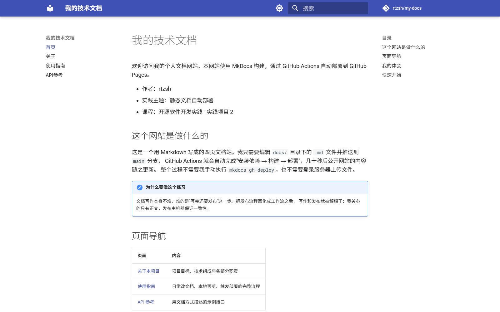
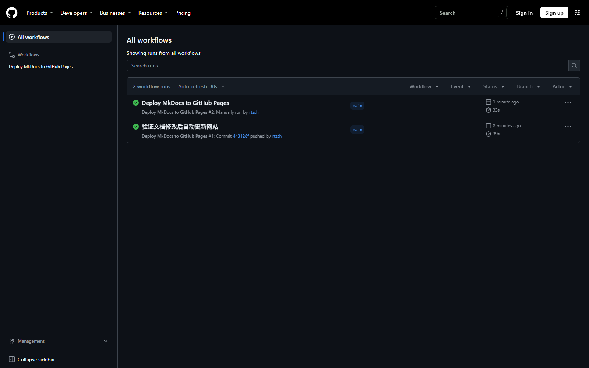

# 实践项目2：个人实验报告

> 提交前请把本文件中所有 `【待填】` 和 `TODO-截图` 换成你自己的内容。
> 截图请放在 `report/images/`，用相对路径引用；不要写 `C:\Users\...` 这类本地路径。

## 1. 基本信息

- 姓名：`【待填：姓名拼音，与 Issue 标题一致】`
- GitHub 登录名：`【待填】`
- 个人仓库地址：https://github.com/rtzsh/my-docs
- 最终网站地址：https://rtzsh.github.io/my-docs/

## 2. 实践过程与关键截图

### 2.1 仓库创建

在 GitHub 上点击右上角 `+` → `New repository`，Owner 选择本人账号，仓库名 `my-docs`，
可见性选择 **Public**，勾选初始化 README，默认分支确认为 `main`。

结果：得到一个地址为 `https://github.com/rtzsh/my-docs` 的公开仓库。

> TODO-截图①：仓库首页，需能看清所有者、仓库名和 `Public` 标识。
> 文件名建议 `images/01-repository.png`


### 2.2 项目结构与 MkDocs 配置

```text
.
├── .github/workflows/deploy.yml
├── docs/{index,about,guide,api}.md
├── report/{README.md,images/}
├── mkdocs.yml
├── requirements.txt
└── .gitignore
```

三个目录/配置各自的职责：

- `docs/`：网站**源码**，四页 Markdown 都在这里，`nav` 里的路径相对它。
- `mkdocs.yml` 的 `nav`：决定侧边栏顺序和标题，写 `index.md` 而不是 `docs/index.md`。
- `site/`：`mkdocs build` 生成的**产物**，已在 `.gitignore` 中排除，不提交、不手改。

> TODO-截图②：项目目录树 + `mkdocs.yml` 内容（VS Code 侧边栏 + 编辑器即可同框）。
> 文件名建议 `images/02-structure.png`


### 2.3 本地构建与预览

```bash
python -m pip install -r requirements.txt
python -m mkdocs build --strict
python -m mkdocs serve
```

`--strict` 把警告当错误处理，用来提前抓出坏链接和缺失的 `nav` 条目。
构建成功输出 `Documentation built in ... seconds`，预览地址为 `http://127.0.0.1:8000/`。

检查内容：四个页面的导航是否齐全、`about.md` 的表格是否正常渲染、
`api.md` 的 JSON 代码块是否高亮、页面之间的链接是否可跳转。

> TODO-截图③：终端里 `Documentation built` 那几行，或本地预览的浏览器画面。
> 文件名建议 `images/03-local-build.png`


### 2.4 Pages 设置

`Settings` → `Pages` → `Build and deployment` → `Source` 选择 **GitHub Actions**。

这一步的作用是：告诉 Pages"不要自己去读某个分支，等 CI 把制品部署过来"。
如果这里仍然停留在 `Deploy from a branch`，工作流即使成功也不会有网站。

> TODO-截图④：Pages 设置页面，Source 一栏为 GitHub Actions。
> 文件名建议 `images/04-pages-source.png`


### 2.5 Actions 首次构建和部署

推送 `main` 后自动触发。`build` 任务做四件事：检出源码、装 Python 与依赖、
`mkdocs build --strict`、上传 `site/` 为制品；`deploy` 任务在 `needs: build` 之后
把制品发布到 `github-pages` 环境。

> TODO-截图⑤：一次成功的运行记录，需同时看到 build 和 deploy 两个绿色对勾。
> 文件名建议 `images/05-actions-first-run.png`


### 2.6 网站访问与四页导航检查

访问 `https://rtzsh.github.io/my-docs/`，逐页确认：

| 页面 | 检查点 | 结果 |
| --- | --- | --- |
| 首页 | 正常加载、导航栏四项都在 | `【待填：通过/不通过】` |
| 关于 | 表格渲染正常 | `【待填】` |
| 使用指南 | 代码块高亮正常 | `【待填】` |
| API 参考 | JSON 代码块、页内链接可跳转 | `【待填】` |

注意项目站的地址必须带仓库路径 `/my-docs/`，少了这一段会 404。

> TODO-截图⑥：网站首页，保留浏览器地址栏。
> 文件名建议 `images/06-site.png`



### 2.7 第二次推送与自动更新验证

在 `docs/index.md` 末尾加一句容易辨认的话（本次实际加入的是"自动部署验证：这是我第二次推送后更新的内容。"），
提交并推送，**没有点任何手动部署按钮**，新的运行由 `push` 自动触发。

- 对应提交：`【待填：粘贴 commit 链接】`
- 对应 Actions 运行：`【待填：粘贴 run 链接】`

运行成功后刷新网站，新句子出现在首页。

> TODO-截图⑦：第二次运行记录 + 网站出现新句子的画面（可拆两张）。
> 文件名建议 `images/07-second-run.png`、`images/08-updated-site.png`




## 3. 问题与解决

> 这一节要写**你自己实际遇到**的问题。下面两条是这类流程里最常出现的，
> 如果你真的遇到了就照实写；如果没有遇到，就删掉，改成"我核对过哪些日志和配置"。

1. **现象**：`mkdocs build --strict` 报 `WARNING - Doc file 'xx.md' contains a link ... which is not found`，
   构建以非零码退出。**原因**：页面间链接写成了 `docs/about.md`，而 MkDocs 按文档目录解析相对链接。
   **解决**：改为 `about.md`，本地 `--strict` 通过后再推送。

2. **现象**：Actions 绿了，但网站仍是旧内容或 404。**排查**：先看 Pages 设置里的 Source 是否为
   GitHub Actions；再确认部署的是 `github-pages` 环境而不是分支。**原因**：Source 仍停留在分支模式。
   **解决**：改回 GitHub Actions 并重新运行工作流。

若一切顺利，则说明核对过：`build` 与 `deploy` 两个任务的每一步日志、Pages 的 Source 设置、
以及 `gh-pages` 分支确实没有创建（本方案不需要它）。

## 4. 原理理解

### 4.1 `docs/` 和 `site/` 各保存什么？为什么不用手工修改 `site/`？

`docs/` 是源码，放 Markdown 和我手写的配置输入，需要纳入版本管理；
`site/` 是 `mkdocs build` 的输出，由模板、主题和 Markdown 渲染而来，属于可再生成的派生文件。
不手改 `site/` 的原因有三点：一是每次构建都会被覆盖，改动无法留存；
二是提交产物会让仓库体积膨胀、diff 充满噪声；三是产物与源码容易不同步，
让人分不清线上内容到底来自哪一版源码。所以 `site/` 写进 `.gitignore`，交给 CI 每次重新生成。

### 4.2 本次工作流在什么情况下自动运行？

只有推送到 `main` 分支、且改动命中 `paths` 里的四个路径之一时才运行：
`docs/**`、`mkdocs.yml`、`requirements.txt`、`.github/workflows/deploy.yml`。
此外 `workflow_dispatch` 允许在 Actions 页面手动触发，用于首次试跑和排错。

### 4.3 `build` 与 `deploy` 两个任务有什么区别？

`build` 负责"生产"：检出源码、准备 Python 3.12、安装依赖、严格构建，并把 `site/` 上传为制品，
它只有 `contents: read` 权限；`deploy` 负责"发布"，通过 `needs: build` 在前者成功后运行，
拿到 `pages: write` 和 `id-token: write`，把制品部署到 `github-pages` 环境并输出 `page_url`。
两者分开的好处是权限最小化，构建代码拿不到发布权限。

### 4.4 只修改 `report/README.md` 会触发部署吗？为什么？

不会。`paths` 过滤器只匹配 `docs/**`、`mkdocs.yml`、`requirements.txt` 和工作流文件自身，
`report/` 不在其中。原因是报告不参与网站内容，没必要因此重跑一次构建与部署；
这也顺带省下了 Actions 的运行时间。

### 4.5 本次方案为何无需创建 `gh-pages` 分支？

因为用的是官方 Pages 的"制品部署"模式：`upload-pages-artifact` 把 `site/` 打包成工作流制品，
`deploy-pages` 直接把它交给 Pages 服务，产物不落到任何分支上。
旧方案要靠 `gh-pages` 分支承载产物，还得维护分支写权限、处理并发推送冲突；
新方案用 OIDC（`id-token: write`）证明身份，不碰仓库内容，所以两者都不需要。

## 5. 附：提交前自检

- [ ] 所有 `rtzsh` 已替换为本人账号
- [ ] `report/images/` 下 8 张截图齐全，且能点开看到图
- [ ] 网站四页可访问，第二次推送的内容已生效
- [ ] 已在教师仓库提交一条 Issue，标题与姓名拼音一致
